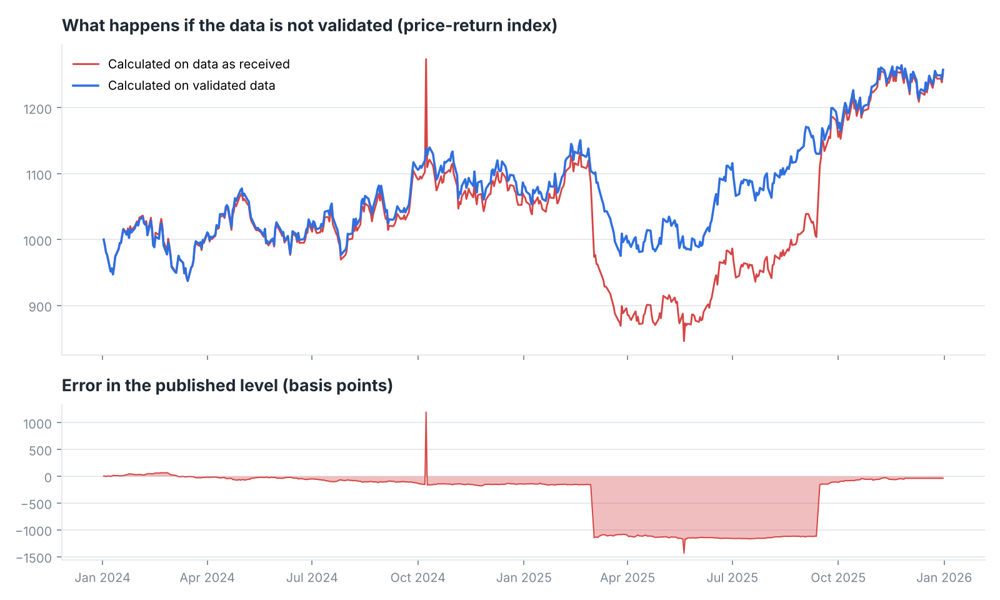
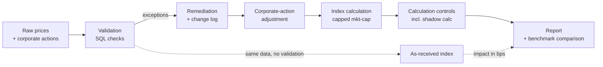
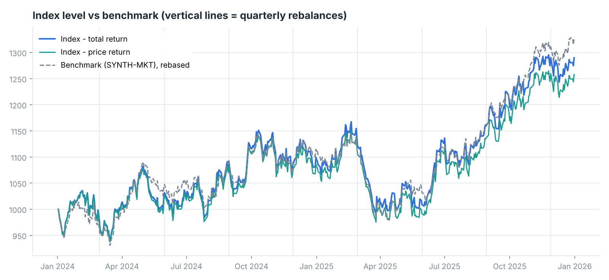
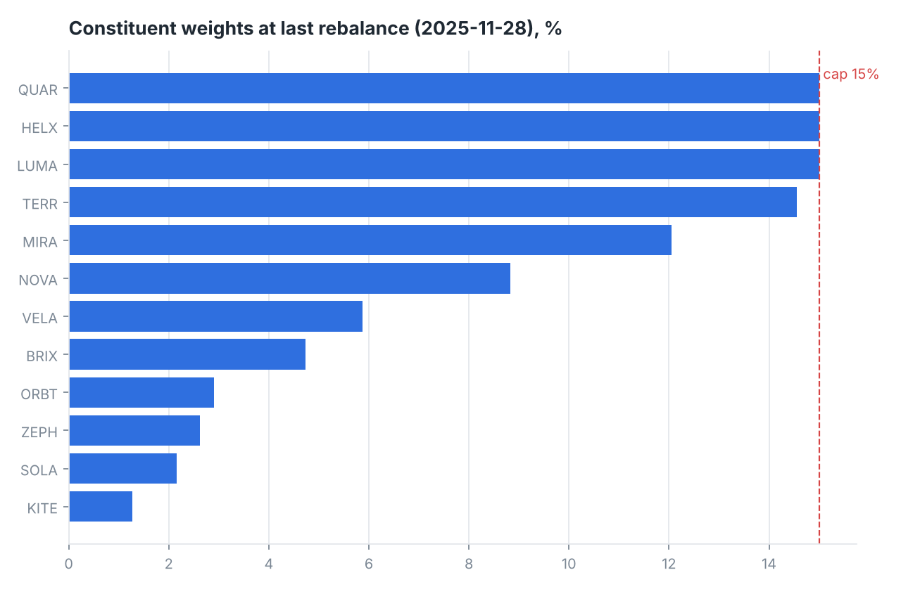

# Index Calculation & Data Validation Engine

[](https://github.com/santiagotolosa004-byte/index-validation-engine/actions/workflows/tests.yml)


An end-to-end replica of an **index production workflow**: raw prices and corporate actions go in,
a validated, capped market-cap-weighted index comes out, together with an exception report,
a remediation log and a set of calculation controls that must pass before a level is "published".

> **Why build this?** An index level is only as good as the data behind it. A single bad tick or a
> missing split can move a published index by hundreds of basis points, and every fund tracking it
> would trade on the wrong number. This project focuses on the unglamorous but critical part:
> **catching data problems before they reach the index**, and proving the calculation is right.



*The same index calculated on the data as received (red) vs. after validation (blue). One fat-finger
tick would have published a level **+11.9%** too high. An unrecorded 3:1 split would have kept the index
**~11.5%** too low for six months, and a single zero price added another **-2.9%** on top.*

---

## Why I built this

I work as a financial analyst evaluating real-estate development projects (cash flows, IRR, ROI,
investor multiples, sensitivity analysis), and I study Data Science & Mathematics Engineering with a
concentration in **Finance and Economics**. My concentration project is to build an equity portfolio
that **outperforms the S&P 500**.

Before trying to pick the companies that could beat the market, I wanted a foundation I could trust:

* **Clean, validated data.** A bad tick or a missing split can make a stock look like a winner (or a
  loser) when it isn't, and any portfolio built on that data inherits the error.
* **A rules-based index engine.** It lets me build portfolios with explicit rules (weights, caps,
  rebalancing) and measure them against the S&P 500 with the metrics that matter: excess return,
  tracking error, beta, information ratio and drawdown.

This project is that foundation. The next step is a stock-selection module that ranks companies and
back-tests the resulting portfolio against SPY on top of this engine.

---

## Results (synthetic run, reproducible with one command)

| | |
|---|---|
| **Known-answer test** | **11 / 11** injected data issues detected, **0** false-positive errors |
| **Calculation controls** | 12 / 12 passed, including an independent *shadow calculation* matching to 1e-15 |
| **Legitimate events** | a recorded 4:1 split is correctly *not* flagged; a genuine -22% move is a *warning for review*, not "fixed" |
| **Test suite** | 34 automated tests, run on every push via GitHub Actions |

The full generated report is in [`docs/sample_output/report.md`](docs/sample_output/report.md).

---

## How it works



1. **Load** raw (unadjusted) closes and a separate corporate-actions table, the same way index vendors
   receive data. Two sources: real data from **Yahoo Finance**, or a **synthetic dataset with known,
   deliberately injected errors** (offline and fully reproducible).
2. **Validate** with SQL in DuckDB. Every check emits exceptions in one standard format
   (`ticker | date | check | severity | value | detail`).
3. **Remediate** only what is clearly wrong and mechanically fixable. Log every change, and leave
   judgement calls flagged for human review.
4. **Adjust** prices for splits and build total-return series with dividends reinvested on the ex-date.
5. **Calculate** a capped market-cap-weighted index (price return and total return) with quarterly rebalancing.
6. **Control** the output: weights sum to 1, cap respected, level continuous through rebalances, no gaps,
   and an **independent shadow calculation** that must match the production calculation.
7. **Report**: exceptions, remediation, performance vs. benchmark (tracking error, beta, IR, drawdown),
   and the **impact in basis points** of skipping validation.

### Validation checks

| Check | Severity | What it catches | Remediation |
|---|---|---|---|
| `duplicate_record` | ERROR | same ticker/date received twice | keep first record received |
| `non_positive_price` | ERROR | zero / negative / null price | remove, carry last valid price |
| `price_spike` | ERROR | large move fully reversed the next day (bad tick) | remove, carry last valid price |
| `possible_unrecorded_split` | ERROR | move matches a split ratio (2:1, 3:1, 1:10…) but no split is recorded | add provisional split, confirm with vendor |
| `split_not_reflected` | ERROR | split recorded, but prices did not move by that ratio | drop the split, confirm with vendor |
| `dividend_outlier` | ERROR | dividend ≤ 0 or > 15% of the share price | exclude from total return |
| `no_data` | ERROR | constituent with no prices at all | exclude from index |
| `missing_price` | WARNING | no record on a day the market traded | carry last valid price |
| `stale_price` | WARNING | 4+ identical consecutive closes | review |
| `price_jump` | WARNING | large one-way move with no split pattern (could be real news) | review, **not** auto-corrected |

The large-move logic distinguishes three cases that look identical to a naive "return > 20%" rule.
A move that reverses the next day is a **bad tick**. A move matching a split ratio is a **missing
corporate action**. Anything else might be **real** and goes to a human.

Example of a check written in SQL (stale prices, gaps-and-islands pattern):

```sql
WITH flagged AS (
    SELECT *, CASE WHEN close = LAG(close) OVER w THEN 0 ELSE 1 END AS new_run
    FROM px_dedup WHERE close > 0
    WINDOW w AS (PARTITION BY ticker ORDER BY date)
),
runs AS (
    SELECT *, SUM(new_run) OVER (PARTITION BY ticker ORDER BY date ROWS UNBOUNDED PRECEDING) AS run_id
    FROM flagged
)
SELECT ticker, MIN(date) AS start_date, COUNT(*) AS identical_closes
FROM runs GROUP BY ticker, run_id
HAVING COUNT(*) >= 4;
```

### Index methodology

| | |
|---|---|
| Weighting | market cap = split-adjusted price × shares outstanding |
| Capping | max 15% per constituent (configurable); excess redistributed pro-rata, iterated until no name breaches the cap |
| Rebalancing | quarterly, at the close of the last trading day of Feb / May / Aug / Nov |
| Calculation | at each rebalance the index buys `units_i = w_i × L / P_i`; between rebalances `L_t = Σ units_i × P_i,t`. New holdings are valued at the same closing prices, so the level is continuous (the role a divisor plays in the classic formula) |
| Variants | price return (split-adjusted prices) and total return (dividends reinvested on ex-date) |
| Shadow calc | independent recomputation `L_t = L_r × Σ w_i × P_i,t / P_i,r` with no holdings; must match the production level |
| Base | 1000 on the first date |

<p float="left">
  
  
</p>

---

## Quick start

```bash
git clone https://github.com/santiagotolosa004-byte/index-validation-engine.git
cd index-validation-engine
python -m venv .venv && source .venv/bin/activate     # Windows: .venv\Scripts\activate
pip install -r requirements.txt

# 1) offline demo with injected data errors (known-answer test)
python -m index_engine --source synthetic

# 2) real data: top-20 US large caps vs SPY
python -m index_engine --source yahoo --start 2024-01-02 --end 2025-12-31 --benchmark SPY --cap 0.10

# tests
pytest
```

Everything is written to `output/`: `report.md`, charts, `exceptions.csv`, `remediation_log.csv`,
`index_levels.csv`, `weights.csv`, `calc_checks.csv`, and an `index_engine.duckdb` database with every
table, so you can query a run with SQL:

```sql
-- duckdb output/index_engine.duckdb
SELECT check, severity, COUNT(*) FROM exceptions GROUP BY ALL ORDER BY 3 DESC;
```

Options: `python -m index_engine --help` (custom universe CSV, cap, dates, `--strict` to fail the run on
any calculation-check failure, `--refresh-shares` to pull current share counts from Yahoo).

## Project structure

```
index_engine/
  data.py           data contracts, Yahoo Finance loader (undoes Yahoo's split adjustment -> raw prices)
  synthetic.py      synthetic market with injected errors + ground truth
  validation.py     SQL (DuckDB) validation checks -> standard exception table
  remediation.py    fixes + change log
  adjustments.py    split adjustment, total-return series
  index_calc.py     capping, rebalancing, holdings-based calculation, shadow calculation
  calc_checks.py    post-calculation controls
  benchmark.py      tracking error, beta, IR, drawdown, impact in bps
  report.py         markdown report + charts
  pipeline.py       orchestration
config/universe.csv constituents and share counts for the real-data run
tests/              34 unit, known-answer and end-to-end tests
```

## Testing

* **Unit tests** cover capping (including cascading caps and infeasible caps), the index formula on
  hand-computed examples, continuity through rebalances, split/dividend adjustments, and the Yahoo
  conversion round-trip. The Yahoo pipeline is also tested end-to-end offline with a mocked `yfinance`.
* **Known-answer tests** inject every type of error into synthetic data and assert that all of them are
  detected with no false-positive errors, **across several random seeds**.
* **End-to-end tests** run the whole pipeline and check the outputs.
* **CI** runs everything on Python 3.11–3.13 on every push, plus a `--strict` production-style run.

## Limitations & next steps

* Share counts are a static snapshot, and the index uses total shares rather than free-float-adjusted shares.
* Only splits and cash dividends are modelled (no spin-offs, mergers, rights issues).
* Next: a **stock-selection module** (factor ranking + back-test vs. SPY) for my S&P 500 portfolio project.
* Next: an **AI layer** that turns the exception table into an incident summary and a client-facing
  technical announcement via an LLM API, plus statistical anomaly detection (rolling z-scores /
  Isolation Forest) compared against the rule-based checks.

---

**Santiago Tolosa Torres** · Data Science & Mathematics Engineering (Finance & Economics concentration),
Tecnológico de Monterrey · Financial Analyst, real-estate development ·
[LinkedIn](https://www.linkedin.com/in/santiagotolosa)
