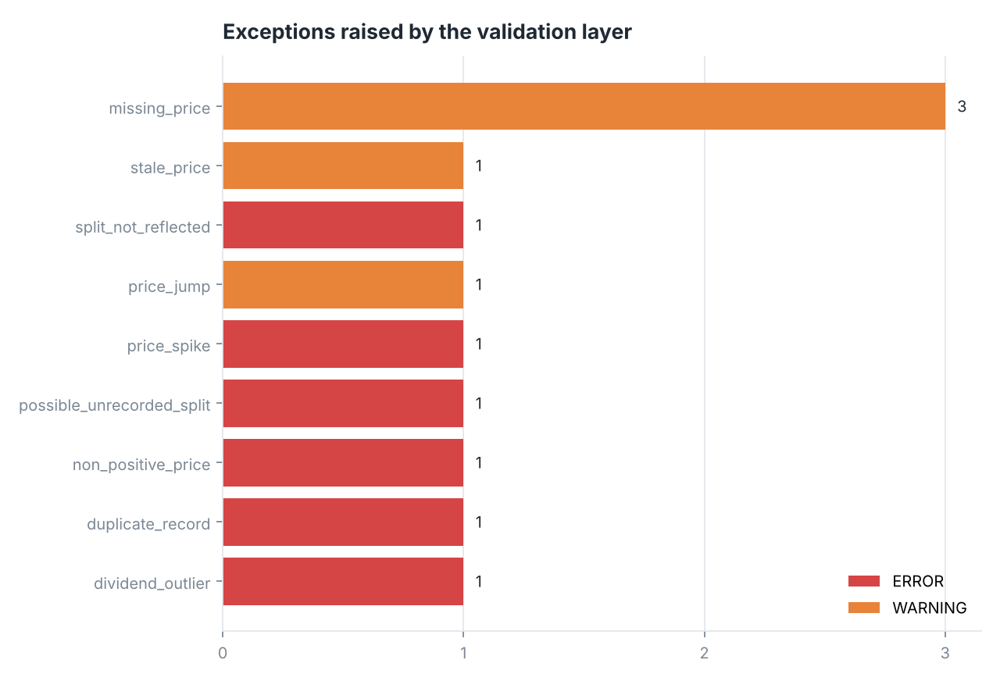
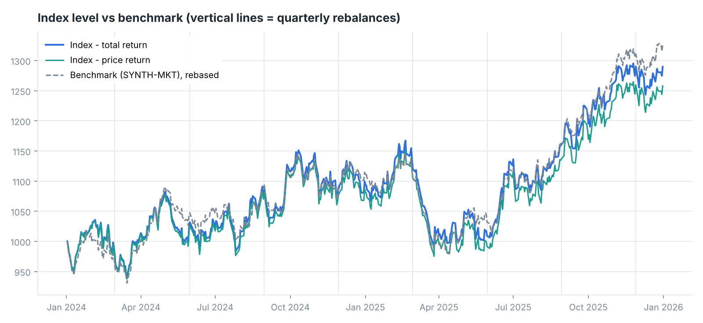
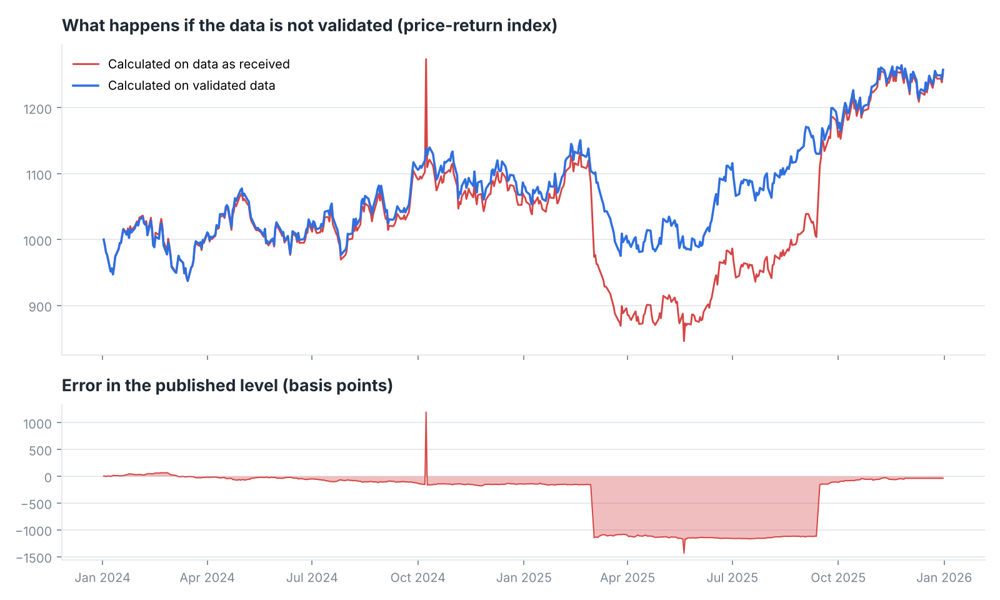
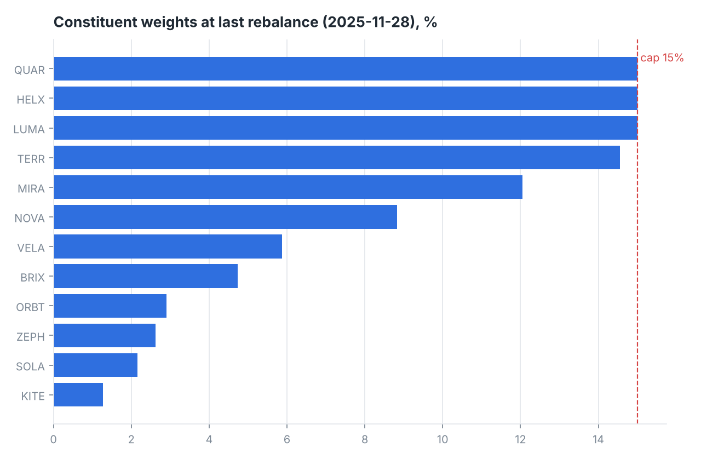

# Index production run report

- **Source:** `synthetic` | **Period:** 2024-01-02 to 2025-12-31 | **Constituents:** 12
- **Methodology:** market-cap weighted, 15% cap, quarterly rebalance (Feb/May/Aug/Nov), base 1000
- **Validation:** 11 exceptions (6 errors, 5 warnings), 11 data changes logged
- **Calculation checks:** PASSED
- **Impact of skipping validation:** max error of 1,435 bps on 2025-05-20

## Known-answer test (synthetic data)

**11 / 11** injected issues detected; **0** false-positive errors.

| ticker | date | expected_check | severity | detected | description |
|---|---|---|---|---|---|
| ORBT | 2024-03-12 | missing_price | WARNING | yes | Price record missing |
| ORBT | 2024-03-13 | missing_price | WARNING | yes | Price record missing |
| ORBT | 2024-03-14 | missing_price | WARNING | yes | Price record missing |
| HELX | 2024-08-05 | stale_price | WARNING | yes | 5 identical closes |
| KITE | 2024-10-08 | price_spike | ERROR | yes | Fat-finger tick: price x10 for one day |
| LUMA | 2025-03-03 | possible_unrecorded_split | ERROR | yes | 3:1 split missing from corporate actions |
| QUAR | 2025-09-15 | split_not_reflected | ERROR | yes | Recorded 2:1 split not visible in prices |
| VELA | 2025-01-15 | duplicate_record | ERROR | yes | Second record with a conflicting price |
| ZEPH | 2025-05-20 | non_positive_price | ERROR | yes | Zero price |
| TERR | 2025-07-10 | dividend_outlier | ERROR | yes | Dividend = 50% of share price |
| MIRA | 2025-10-21 | price_jump | WARNING | yes | Legitimate -22% move (should be a WARNING, not corrected) |

## Calculation checks

| check | status | detail |
|---|---|---|
| PR: weights_sum_to_one | PASS | max abs(sum - 1) = 2.22e-16 across 9 rebalances |
| PR: cap_respected | PASS | max weight 15.00% vs cap 15.00% |
| PR: rebalance_continuity | PASS | max level gap at rebalance = 2.22e-16 |
| PR: no_missing_levels | PASS | 0 missing levels |
| PR: shadow_calculation_match | PASS | max relative difference = 6.66e-16 |
| PR: daily_move_within_bounds | PASS | largest daily move 3.46% on 2025-03-27 (limit 15%) |
| TR: weights_sum_to_one | PASS | max abs(sum - 1) = 2.22e-16 across 9 rebalances |
| TR: cap_respected | PASS | max weight 15.00% vs cap 15.00% |
| TR: rebalance_continuity | PASS | max level gap at rebalance = 2.22e-16 |
| TR: no_missing_levels | PASS | 0 missing levels |
| TR: shadow_calculation_match | PASS | max relative difference = 6.66e-16 |
| TR: daily_move_within_bounds | PASS | largest daily move 3.46% on 2025-03-27 (limit 15%) |

## Exceptions

| severity | check | ticker | date | detail | remediation |
|---|---|---|---|---|---|
| ERROR | dividend_outlier | TERR | 2025-07-10 | dividend 100.36 = 50.0% of previous close 200.73 | Dividend excluded from total-return calculation (confirm with vendor) |
| ERROR | duplicate_record | VELA | 2025-01-15 | 2 records; prices 102.12 / 105.18 | Kept first record received; later conflicting record discarded |
| ERROR | non_positive_price | ZEPH | 2025-05-20 | close = 0.0 | Price removed and last valid price carried forward |
| ERROR | possible_unrecorded_split | LUMA | 2025-03-03 | -66.7% move matches a 3:1 split; none recorded | Provisional split added to corporate actions (confirm with vendor) |
| ERROR | price_spike | KITE | 2024-10-08 | +918.0% move fully reversed next day (prev close 107.89) | Erroneous tick removed and last valid price carried forward |
| ERROR | split_not_reflected | QUAR | 2025-09-15 | recorded 2:1 split but prices moved 1.01x | Split removed from corporate actions (confirm with vendor) |
| WARNING | missing_price | ORBT | 2024-03-12 | no price record on a trading day | Last valid price carried forward |
| WARNING | missing_price | ORBT | 2024-03-13 | no price record on a trading day | Last valid price carried forward |
| WARNING | missing_price | ORBT | 2024-03-14 | no price record on a trading day | Last valid price carried forward |
| WARNING | price_jump | MIRA | 2025-10-21 | -22.0% one-day move (not reversed, no split pattern) | No change - review against news / corporate events |
| WARNING | stale_price | HELX | 2024-08-05 | 5 identical closes of 174.98 until 2024-08-09 | No change - review (possible halt, illiquidity or feed problem) |

## Performance vs benchmark

| metric | index (TR) | SYNTH-MKT |
|---|---|---|
| Annualised return | 13.09% | 14.63% |
| Annualised volatility | 16.99% | 14.39% |
| Max drawdown | -15.21% | -14.48% |

Tracking error **6.71%**, correlation **0.922**, beta **1.09**, information ratio **-0.23** (521 daily observations).

## Impact of skipping validation

The same methodology run on the data exactly as received (no validation, no remediation).

## Weights

